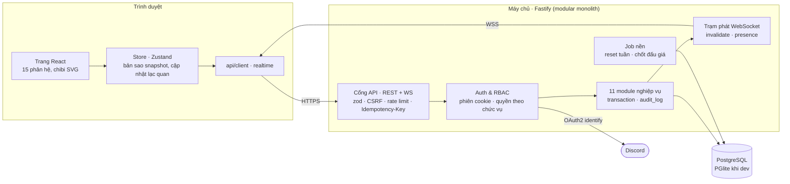
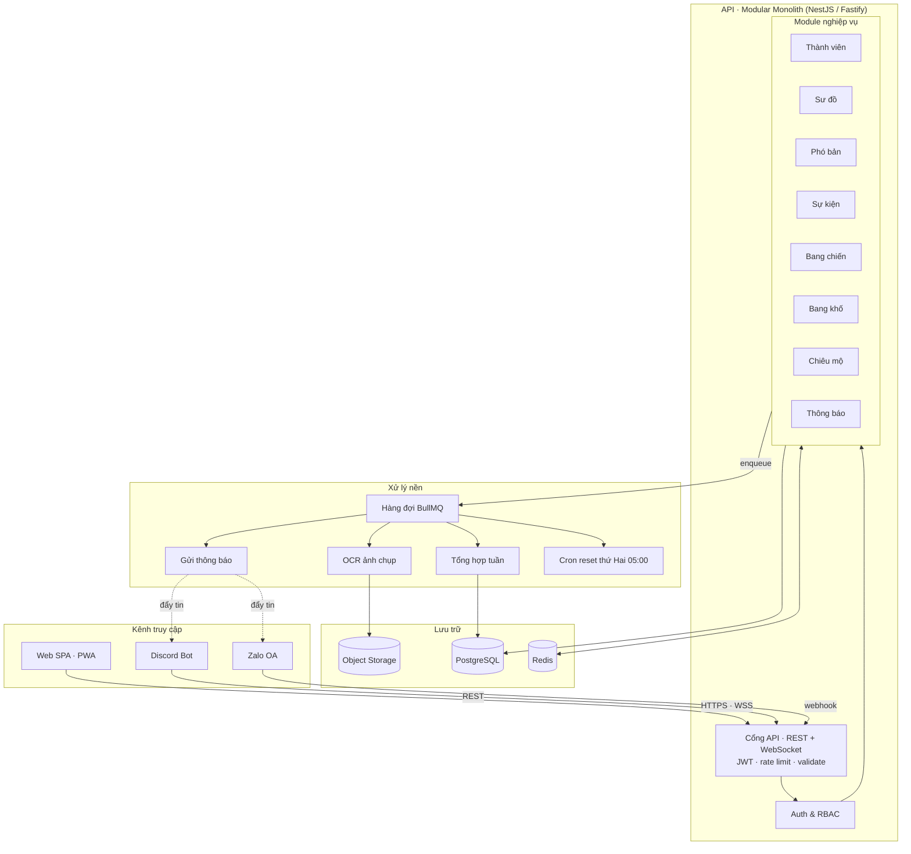
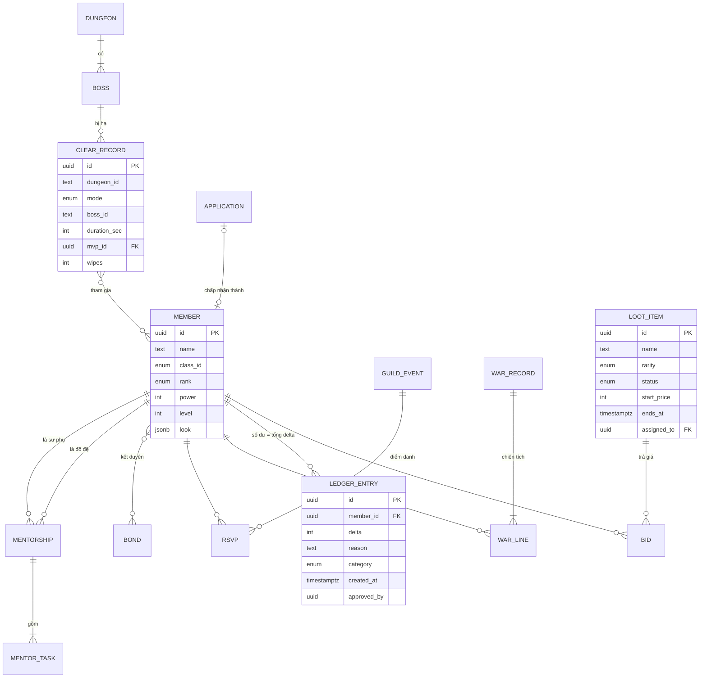
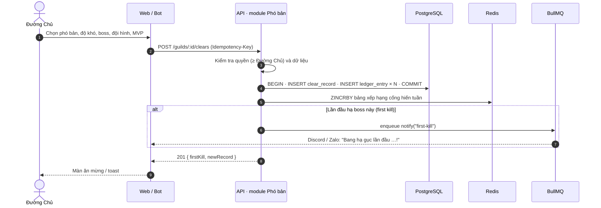
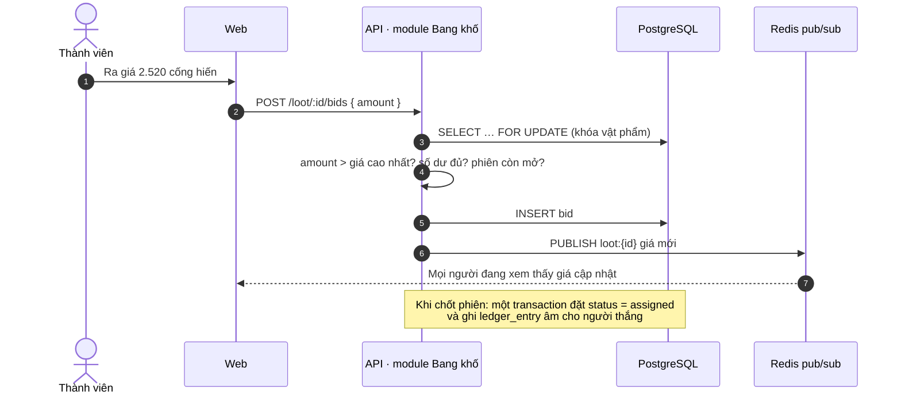

# Kiến trúc hệ thống — Thủy Hàn Lệnh

> Hệ thống quản lý **bang hội, Kim Lan và team** cho **Nghịch Thủy Hàn Mobile**. Tài liệu này mô tả bản demo đang chạy và kiến trúc đề xuất cho bản chính thức.
> Xem trực quan trong app: trang **Kiến Trúc** (`/kien-truc`).

---

## 1. Tóm tắt

| | Giai đoạn 1 (demo) | **Giai đoạn 2–3 — đang chạy** | Giai đoạn 4–5 |
|---|---|---|---|
| Phạm vi | 1 bang | **Nhiều tổ chức**: bang hội · Kim Lan (12 người) · team tự lập | Liên minh, thống kê theo mùa |
| Chạy ở đâu | Chỉ trình duyệt | Trình duyệt + máy chủ Fastify | + worker nền, nhiều instance |
| Dữ liệu | `localStorage` | **PostgreSQL** (PGlite nhúng khi dev) | + Redis, Object storage |
| Đăng nhập | Công tắc "Đóng vai" | **Discord OAuth2** + phân quyền theo chức vụ (đăng nhập thử khi dev) | |
| Realtime | Không | **WebSocket** — trạm phát trong tiến trình | Redis pub/sub |
| Job nền | Không | Reset tuần, tự chốt đấu giá (trong tiến trình, khóa idempotent) | BullMQ: thông báo, OCR |
| Thông báo | Toast | Toast + nhật ký bang | Discord bot, Zalo OA, Web Push |

Nguyên tắc giữ từ giai đoạn 1: **giao diện không phải viết lại khi lên backend**. Store giữ nguyên tên action, chỉ đổi phần bên trong từ `set()` sang gọi API. Hợp đồng chi tiết của giai đoạn 2: [`docs/superpowers/specs/2026-10-22-phase2-backend-design.md`](superpowers/specs/2026-10-22-phase2-backend-design.md).

---

## 2. Hệ thống đang chạy (giai đoạn 2)

| Lớp | Thư mục | Vai trò |
|---|---|---|
| Trang | `src/pages/*` | Hiển thị, form; ẩn/khóa nút theo quyền (`useCan`). |
| Store | `src/store/guild.ts` | Bản sao dữ liệu server; action async gọi API, ghép slice trả về, hoàn tác khi lỗi. |
| Cổng đăng nhập | `src/auth/*` | `/api/me` → Đăng nhập / Nhập môn / vào app; mở WebSocket. |
| Hợp đồng chung | `src/domain/*` | Kiểu dữ liệu, hằng số, `api.ts` (snapshot, slice), `permissions.ts` — server import chung. |
| Máy chủ | `server/src/*` | Fastify, Drizzle, auth, module nghiệp vụ, realtime, job nền. |
| CSDL | `server/drizzle/*` | Migration SQL, kể cả trigger sổ cái append-only. |

**Luồng một thao tác ghi:** trang gọi action → `POST /api/...` (kèm `Idempotency-Key` khi tạo mới) → server kiểm quyền + dữ liệu → transaction (ghi + `audit_log` + nhật ký bang) → trả `{ ok, result, snapshot }` gồm đúng các slice đã đổi → store ghép vào → server phát `invalidate` qua WebSocket → các máy khác tải lại đúng các slice đó.

---

## 2b. Nhiều tổ chức (giai đoạn 3)

Hợp đồng chi tiết: [`docs/superpowers/specs/2026-10-22-phase3-multi-org-design.md`](superpowers/specs/2026-10-22-phase3-multi-org-design.md).

| Loại | Sức chứa | Chức vụ | Chức năng |
|---|---|---|---|
| **Bang Hội** 帮 | 80 (chỉnh tới 200) | Bang Chủ → Tân Binh (7 bậc) | Đủ bộ, nhận đơn công khai |
| **Kim Lan** 金兰 | tối đa 12 | Đại ca + huynh đệ; **thứ bậc theo ghế** 1–12 (Đại ca/tỷ, Nhị ca… Tiểu đệ/muội) | Cố định như trong game: Phó Bản, Bày Trận, Lịch phó bản |
| **Team** 队 | không giới hạn | Trưởng nhóm, Phó nhóm (≤ 3), Thành viên | Trưởng nhóm tự bật/tắt (mặc định: phó bản, bày trận, lịch, xếp hạng) |

- **Một tài khoản = một nhân vật** (`characters`: tên, lưu phái, cấp, chiến lực, chibi) dùng chung mọi tổ chức. `members` giờ là **tư cách thành viên** (tổ chức + nhân vật + chức vụ + ghế + ngày vào). Chỉ chủ nhân vật mới sửa được thông tin nhân vật.
- **Chọn tổ chức** bằng header `x-org-id` (WebSocket: `?org=`). Server kiểm tra tư cách thành viên, nạp quyền theo **loại tổ chức** (`PERMISSION_MIN_RANK_BY_TYPE`).
- **Ẩn chức năng không có trong game:** route của chức năng đang tắt trả `404 feature_off`; snapshot trả slice rỗng; menu, thanh lệnh và trang đều ẩn theo `org.features`. Kim Lan chỉ tạo được sự kiện phó bản / boss.
- **Vào tổ chức:** link mời `/moi/:code` (gia nhập, hoặc *nhận danh tính* một nhân vật chưa có chủ), đơn xin vào bang công khai, hoặc tự lập. Người chưa ở đâu thấy **Sảnh Giang Hồ**.
- **Giao diện theo tổ chức:** `data-org-theme` trên `<html>` — Kinh Hồng (vàng, hoa đào), **Bạch Gia** (bạch kim, tuyết, bạch mai, hạc trắng), Thanh Ngọc, Hồng Liên, Tử Đằng.
- Dữ liệu mẫu: **Kinh Hồng Các** (bang 49 người), **Gia Tộc Họ Bạch** (Kim Lan 12 người, 3 người cũng ở Kinh Hồng Các), **Thất Tinh Đội** (team 7 người lấy từ bang).

---

## 3. Kiến trúc đích (giai đoạn 4–5)

**Modular monolith**: một backend duy nhất, chia module rõ ràng; phần nặng (thông báo, OCR, tổng hợp) chạy nền qua hàng đợi. Giai đoạn 2 đã dựng phần lõi (API, Auth & RBAC, 9 module, PostgreSQL, WebSocket, job nền trong tiến trình); Redis, BullMQ, Discord bot, Zalo OA, OCR và object storage là phần của giai đoạn 3.

### Các thành phần

| Thành phần | Công nghệ | Trách nhiệm |
|---|---|---|
| Web SPA / PWA | React 19, Vite, Tailwind v4 | Giao diện chính, cài lên điện thoại được |
| Discord Bot | discord.js | Lệnh `/diemdanh`, `/tiendo`, nhắc lịch, báo first kill |
| Zalo OA | Zalo OA API | Thông báo cho người không dùng Discord |
| Cổng API | NestJS hoặc Fastify, Zod, Socket.IO | Xác thực, giới hạn tần suất, kiểm tra đầu vào, realtime |
| PostgreSQL 16 | | Nguồn sự thật duy nhất |
| Redis 7 | | Cache, bảng xếp hạng (sorted set), pub/sub cho WebSocket, khóa phân tán |
| Object storage | S3 / Cloudflare R2 | Ảnh chụp chỉ số, avatar, file xuất báo cáo |
| BullMQ | | Hàng đợi job bền vững, tự thử lại |

---

## 4. Module và endpoint chính

| Module | Thực thể | Endpoint tiêu biểu |
|---|---|---|
| Auth & RBAC | User, Session, RankPermission | `GET /auth/discord/callback`, `GET /me` |
| Tổ chức (gđ 3) | Org, Character, OrgInvite | `POST /api/orgs`, `PATCH /api/orgs/current`, `POST /api/orgs/current/leave`, `POST /api/characters`, `POST /api/invites`, `POST /api/invites/:code/accept`, `PUT /api/members/:id/seat` |
| Thành viên | Member, PowerSnapshot | `GET /guilds/:id/members`, `PATCH /members/:id`, `PUT /members/:id/rank` |
| Sư đồ | Mentorship, MentorTask | `POST /mentorships`, `PATCH /mentorships/:id/tasks/:taskId`, `POST /mentorships/:id/graduate` |
| Phó bản | Dungeon, Boss, BossProgress, ClearRecord | `POST /guilds/:id/clears`, `GET /guilds/:id/progress` |
| Sự kiện | GuildEvent, Rsvp | `POST /guilds/:id/events`, `PUT /events/:id/rsvp`, kênh WS `events:rsvp` |
| Bang chiến | WarRecord, WarLine | `POST /guilds/:id/wars`, `GET /wars/:id` |
| Bang khố | LedgerEntry, LootItem, Bid | `POST /loot/:id/bids`, `POST /loot/:id/close`, `POST /ledger/adjustments` |
| Chiêu mộ | Application | `POST /guilds/:id/applications`, `PATCH /applications/:id/stage`, `POST /applications/:id/accept` |
| Thông báo | Announcement, Activity, NotificationJob | `POST /guilds/:id/announcements`, `GET /guilds/:id/activities` |

---

## 5. Mô hình dữ liệu

Định nghĩa đầy đủ ở `src/domain/types.ts`.

Ghi chú:
- **Số dư cống hiến không lưu cứng** (đã làm): là tổng `delta` của `ledger_entries`; cống hiến tuần = tổng `delta > 0` từ thứ Hai 05:00. Trigger `ledger_entries_append_only` chặn UPDATE/DELETE.
- `power_history (character_id, week_start, power)` (đã làm) — job reset tuần ghi một dòng mỗi tuần cho mỗi nhân vật đang ở ít nhất một tổ chức (biểu đồ 8 tuần, dùng chung mọi tổ chức).
- Giai đoạn 3: `guilds` là bảng **tổ chức** (thêm `type`, `features`, `theme`, `is_public`, `created_by`), `characters` tách khỏi `members`, `members.seat` cho Kim Lan, `org_invites` cho link mời.
- Tiến độ phó bản (đã làm) tính từ `clears` — first kill = bản ghi sớm nhất, kỷ lục = `min(duration_sec)`.
- Trục xuất là **xóa mềm** (`members.deleted_at`) để sổ cái và lịch sử vẫn nguyên vẹn; tài khoản được giải phóng để nhập môn lại.

---

## 6. Luồng nghiệp vụ

### 6.1 Ghi nhận một lượt clear

### 6.2 Đấu giá chiến lợi phẩm

---

## 7. Những quyết định thiết kế

1. **Modular monolith thay vì microservices.** Một bang vài trăm người không cần hạ tầng phân tán. Ranh giới module rõ để sau này tách phần nóng (thông báo, OCR) mà không viết lại.
2. **Sổ cống hiến append-only.** Không `UPDATE`/`DELETE` bút toán; sai thì thêm bút toán điều chỉnh có người duyệt. Số dư luôn tính lại được, chống gian lận khi chia đồ.
3. **RBAC theo chức vụ bang.** Quyền gắn với chức vụ, không gắn với từng người.
4. **Bảng xếp hạng: SQL trước, Redis sau.** Bang ≤ 80 người thì tổng hợp SQL đủ nhanh; Redis sorted set chỉ thêm khi nhiều bang / nhiều instance.
5. **Realtime qua WebSocket.** Server chỉ phát tín hiệu "slice nào đã đổi", máy khách tự tải lại phần đó — đơn giản, không lệch dữ liệu. Chạy nhiều instance thì thay trạm phát trong tiến trình bằng Redis pub/sub.
6. **Job reset tuần idempotent.** Cron thứ Hai 05:00 dùng khóa theo mã tuần (VD `2026-W43`); chạy lại không cộng/xóa trùng.
7. **Ghi nhận có Idempotency-Key.** Bấm "Ghi nhận" hai lần (mạng chậm) không tạo hai lượt clear.
8. **OCR là job bất đồng bộ.** Upload ảnh → worker đọc chiến lực → người dùng xác nhận. API không bị chặn bởi xử lý ảnh.
9. **Fastify thay vì NestJS.** NestJS cần `emitDecoratorMetadata`, thứ mà `tsx`/esbuild không sinh — DI sẽ hỏng khi chạy dev. Fastify nhẹ, plugin rõ ràng, chạy TypeScript trực tiếp.
10. **PGlite khi dev và test.** PostgreSQL thật biên dịch sang WASM, chạy nhúng: không cần cài Postgres/Docker, test tích hợp tạo CSDL mới trong RAM cho từng file test.
11. **Phiên lưu trong CSDL, không dùng JWT.** Thu hồi được ngay (đăng xuất, trục xuất); cookie `httpOnly` + `SameSite=Lax`, CSDL chỉ giữ SHA-256 của token.

---

## 8. Phân quyền đề xuất

| Thao tác | Tân Binh | Thành Viên | Tinh Anh | Đường Chủ | Trưởng Lão | Phó Bang | Bang Chủ |
|---|:-:|:-:|:-:|:-:|:-:|:-:|:-:|
| Xem mọi trang, điểm danh, ra giá | ✔ | ✔ | ✔ | ✔ | ✔ | ✔ | ✔ |
| Nhận đồ đệ | | | ✔ | ✔ | ✔ | ✔ | ✔ |
| Ghi nhận clear / bang chiến, tạo sự kiện | | | | ✔ | ✔ | ✔ | ✔ |
| Duyệt đơn chiêu mộ, mở đấu giá | | | | | ✔ | ✔ | ✔ |
| Điều chỉnh cống hiến, chốt phiên | | | | | | ✔ | ✔ |
| Bổ nhiệm chức vụ, trục xuất | | | | | | ✔ (≤ Trưởng Lão) | ✔ |

**Kim Lan:** mọi huynh đệ được điểm danh, ghi nhận phó bản, tạo lịch, xếp đội; Đại ca/Đại tỷ đổi ghế, mời người, sửa thông tin Kim Lan. Đưa ai lên ghế 1 là nhường vị trí đứng đầu.
**Team:** Thành viên điểm danh, ra giá, nhận đồ đệ; Phó nhóm quản lý hằng ngày (ghi nhận, lịch, duyệt đơn, mời); chỉ Trưởng nhóm bật/tắt chức năng, bổ nhiệm, mời ra, chốt quỹ.

---

## 9. Vận hành

- **Triển khai:** `docker compose up -d --build` (file `docker-compose.yml`: Postgres 17 + app; app phục vụ luôn web). Khi lớn dùng dịch vụ quản lý (Render / Fly.io + Postgres managed) — máy chủ tự đọc biến `PORT`.
- **Hiệu năng tải:** bản build nén sẵn brotli/gzip; file `assets/*` (tên có mã băm) cache 1 năm, `index.html` luôn hỏi lại máy chủ; phản hồi API nén brotli mức 4 (snapshot bang ~240 KB → ~44 KB). Thư viện biểu đồ và các trang con tải lazy.
- **CI/CD:** GitHub Actions — `tsc`, test, build, migrate, deploy.
- **Giám sát:** OpenTelemetry trace cho từng request, Sentry cho lỗi giao diện và API, cảnh báo khi job thông báo thất bại liên tiếp.
- **Sao lưu:** Postgres backup hằng ngày (giữ 14 ngày) + xuất JSON theo bang (giống nút "Xuất JSON" của bản demo).
- **Di trú dữ liệu demo:** `npm run db:import -- file.json` nạp file "Xuất JSON" của bản demo cũ (cùng cấu trúc `SeedData`); importer tự sinh bút toán "số dư đầu kỳ" và lượt clear lịch sử để số liệu tính ra khớp bản cũ.

---

## 10. Lộ trình

| Giai đoạn | Nội dung | Trạng thái |
|---|---|---|
| 1 | Bản demo frontend: 15 phân hệ, chibi SVG, lưu trong trình duyệt | ✔ Xong |
| 2 | Backend Fastify + PostgreSQL, đăng nhập Discord, phân quyền, realtime, job nền | ✔ Xong |
| 3 | Nhiều tổ chức: bang hội, Kim Lan (thứ bậc kết nghĩa), team tự lập; nhân vật dùng chung; link mời; giao diện theo tổ chức | ✔ Xong |
| 4 | Discord bot điểm danh, thông báo Zalo, OCR ảnh chụp chỉ số, Redis + BullMQ | Kế tiếp |
| 5 | PWA, liên minh giữa các bang, thống kê theo mùa | |
